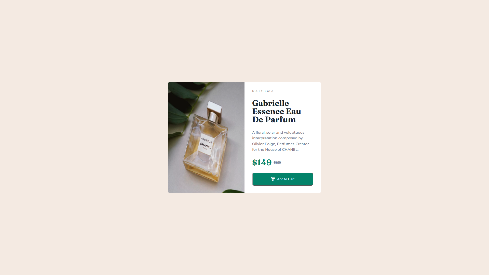

# Frontend Mentor - Product Preview Card Component

This is my solution to the [Product Preview Card Component challenge on Frontend Mentor](https://www.frontendmentor.io/challenges/product-preview-card-component-GO7UmttRfa).

## Table of Contents

- [Overview](#overview)
- [Screenshot](#screenshot)
- [Links](#links)
- [Built With](#built-with)
- [What I Learned](#what-i-learned)
- [Author](#author)

## Overview

The goal of this challenge was to build a responsive product preview card that closely matches the provided design.

The component presents a product image, product information, pricing, and an Add to Cart button. The layout adapts to different screen sizes and includes a hover state for the button.

## Screenshot

## Links

- **Solution:** [GitHub repository](https://github.com/promahmoud219/product-preview-card-component)
- **Live site:** [View the live project](https://promahmoud219.github.io/product-preview-card-component/)

## Built With

- Semantic HTML5
- CSS custom properties
- Flexbox
- Sass (SCSS)
- Mobile-first workflow
- Media queries for responsive layouts

## What I Learned

Building this project helped me strengthen my understanding of HTML, CSS, and Sass through practical implementation.

### CSS and Layout

- Used a universal selector to reset default margins and padding and applied `box-sizing: border-box` to make element sizing more predictable.
- Practiced combining `min()` and `calc()` to create a flexible card width that respects a maximum width while adapting to narrower viewports.
- Learned how `margin-block` controls spacing on the block axis and how `margin-inline: auto` can center an element horizontally.
- Used Flexbox to arrange the product information, pricing, and call-to-action button.

### Sass and Design Tokens

- Organized styles into separate files for colors, spacing, and typography.
- Used CSS custom properties to reuse design tokens consistently.
- Explored Sass maps and mixins to group typography properties into reusable text presets.
- Learned how `map.get()` retrieves values from a Sass map and how validation can catch unknown presets during compilation.

I used AI assistance to explore and understand parts of the Sass implementation, particularly maps, mixins, and reusable typography configurations.

### Semantic HTML and Accessibility

- Used semantic elements such as `<main>`, `<article>`, and `<h1>` to give the page a meaningful structure.
- Chose elements such as ``, `
`, `<strong>`, and `<del>` according to their intended roles.
- Added descriptive alternative text to the product image.
- Used `aria-hidden="true"` for the decorative cart icon to avoid redundant screen-reader announcements.

### Responsive Design

- Followed a mobile-first approach, starting with the mobile layout and adapting the component for larger viewports.
- Used the mobile product image on smaller screens and the desktop image for tablet and desktop layouts.
- Applied flexible sizing with `min()` and `calc()` to help the card fit narrower screens.
- Used media queries to adapt the layout at larger viewport widths.

### Key Takeaway

The most valuable lesson was understanding why CSS rules work, testing their effects in the browser, and making layout decisions based on the design requirements rather than blindly copying values.

## Author

- GitHub: [@promahmoud219](https://github.com/promahmoud219)
- Frontend Mentor: [@promahmoud219](https://www.frontendmentor.io/profile/promahmoud219)
